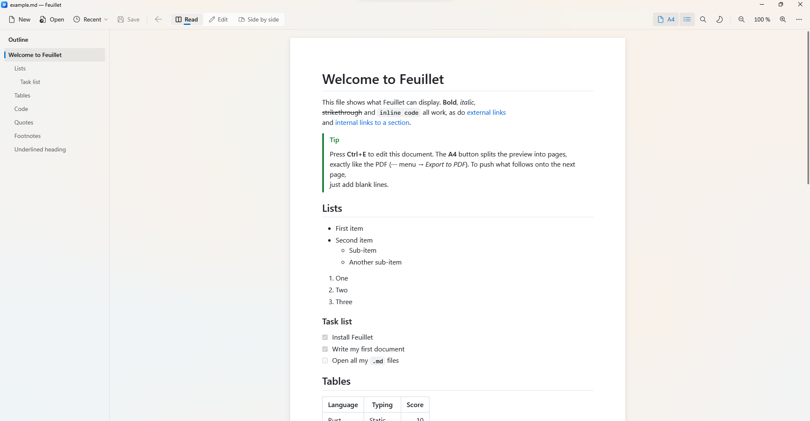

<p align="center">
  
</p>

<h1 align="center">Feuillet</h1>

<p align="center">
  <b>The Markdown editor for Windows 11 that thinks in pages.</b><br>
  Write in Markdown, see your A4 pages live, export a clean PDF.
</p>

<p align="center">
  
  
  
  
</p>

<p align="center">
  
</p>

---

## Overview

Feuillet (French for *leaf of paper*) is a Markdown (`.md`) editor and viewer for Windows 11.
It renders documents exactly like GitHub, and splits the preview into **A4 pages**:
what you see on screen is what you get in the PDF.

It is light (a single executable of a few MB), fast, needs no account or internet
connection, and your files stay plain text files that open anywhere.

The interface is available in **English** and **French**. Feuillet follows the Windows
display language by default; you can change it from the **⋯** menu → **Language**.

## Features

**Read**
- GitHub-identical rendering: headings, tables, task lists, `[!NOTE]` alerts,
  footnotes, images, syntax highlighting with a “copy” button
- Clickable outline that follows your reading position
- Find in document (ignores case and accents)
- Links to other `.md` files open in Feuillet, web links open in your browser
- Automatic reload when the file is changed by another program

**Write**
- Three modes: Read, Edit, Side by side (live preview)
- Editor with Markdown highlighting, undo / redo, find / replace
- Formatting toolbar: bold, headings, lists, tasks, links, images, code, tables…
- Line breaks are kept: pressing Enter in the file starts a new line in the preview
  (can be turned off in the ⋯ menu for standard Markdown, where a single line break is
  just a space)
- Warning before losing unsaved changes

**Lay out**
- **A4 mode**: the preview is split into pages, and the editor shows where each page starts
- **Blank lines count**: to push content onto the next page, just add blank lines to the
  file. A blank line at the bottom of a page disappears, so a page never starts with empty space.
- Explicit page breaks are recognized: `<!-- pagebreak -->`, `\newpage`, `\pagebreak`
  (and the French `<!-- saut de page -->`)
- **PDF export** in A4 format (20 mm margins, always in light theme) and printing

**Windows 11**
- Fluent interface: Mica background, Segoe Fluent icons, system accent color
- Light / dark theme, zoom, recent files, drag and drop
- English and French interface, following the Windows language
- `.md` file association (double-click in File Explorer)
- Right-click → **New** → **Markdown document** in File Explorer, with the Feuillet icon;
  the empty file opens straight in editing mode

**Reliability**
- Encodings detected and preserved: UTF-8 (with or without BOM), UTF-16, Windows-1252;
  Windows line endings preserved
- Safe saving: a file is never left half-written
- Security: HTML in documents is sanitized (no scripts), links cannot launch programs,
  binary files and files over 20 MB are refused

## Installation

1. Download `Feuillet-v1.0-setup.exe` from the [Releases](../../releases) page.
2. Run it. No administrator rights are needed. The installer is in English or French,
   depending on your Windows language.
3. Check “Open .md and .markdown files with Feuillet” to open them with a double-click,
   and “Add Markdown document to the File Explorer New menu” to create one with a right-click
   (both are on by default).

**Requirements**: Windows 11 (or Windows 10 with the
[WebView2 Runtime](https://developer.microsoft.com/microsoft-edge/webview2/), already present
on most machines), 64-bit processor.

> Windows SmartScreen may show a warning on first launch, because the installer is not
> digitally signed. Click “More info”, then “Run anyway”.

The installer automatically replaces the previous version, called “Visionneuse Markdown”,
if it is installed.

## Usage

Open a `.md` file (double-click, drag and drop, or `Ctrl+O`), then press `Ctrl+E` to edit it.

**Preparing a clean PDF**
1. Turn on **A4** mode (button at the top right, on by default).
2. Switch to Side by side mode (`Ctrl+E`): the preview shows the pages, and the editor
   shows “Page n” markers.
3. If a heading or a table falls badly, add a few blank lines before it until it moves
   to the next page.
4. **⋯** menu → **Export to PDF** (`Ctrl+Shift+P`).

**Changing the language**: **⋯** menu → **Language** → *Automatic (Windows)*, *Français*
or *English*. The change is immediate, no restart needed.

### Keyboard shortcuts

| Key                              | Action                                   |
|----------------------------------|------------------------------------------|
| `Ctrl+O` / `Ctrl+N`              | Open / new document                      |
| `Ctrl+S` / `Ctrl+Shift+S`        | Save / save as                           |
| `Ctrl+E`                         | Side-by-side editing / back to reading   |
| `Ctrl+B` / `Ctrl+I` / `Ctrl+K`   | Bold / italic / link (in the editor)     |
| `Ctrl+F`                         | Find (in the editor: find / replace)     |
| `Ctrl+Shift+P` / `Ctrl+P`        | Export to PDF / print                    |
| `Ctrl+T`                         | Show / hide the outline                  |
| `Ctrl+D`                         | Light / dark theme                       |
| `Ctrl +` / `Ctrl -` / `Ctrl 0`   | Zoom (or `Ctrl` + mouse wheel)           |
| `F5`                             | Reload the file                          |
| `Alt+←`                          | Previous document                        |

## Building from source

**Prerequisites**
- [Rust](https://rustup.rs) (stable)
- [Node.js](https://nodejs.org) 20 or later
- WebView2 (already present on Windows 11)
- For the installer: [Inno Setup 6](https://jrsoftware.org/isinfo.php)

**Build**

```powershell
npm install
npx tauri build --no-bundle
```

The executable is created at `src-tauri\target\release\feuillet.exe`.

> With the GNU Rust toolchain (MinGW), `WebView2Loader.dll` must sit next to the executable;
> the build creates it in the same folder.

**Development** (hot reload of the interface):

```powershell
npx tauri dev
```

**Installer**:

```powershell
& "$env:LOCALAPPDATA\Programs\Inno Setup 6\ISCC.exe" installer\setup.iss
```

It is created at `release\Feuillet-v1.0-setup.exe`.

**Tests**:

```powershell
cd src-tauri
cargo test
cargo run --example render < ..\example.md   # prints the generated HTML
```

## Architecture

```
├── index.html            Window structure
├── src/                  Interface (JavaScript, Vite)
│   ├── main.js           Application: files, modes, preview, PDF
│   ├── i18n.js           Translations (English, French)
│   ├── editor.js         Editor (CodeMirror 6) and page markers
│   ├── format.js         Formatting commands
│   ├── pages.js          A4 pagination
│   ├── find.js           Find in preview
│   └── style.css         Windows 11 (Fluent) style
├── src-tauri/            Core (Rust, Tauri 2)
│   └── src/
│       ├── main.rs       Commands: read, save, render, export to PDF
│       ├── markdown.rs   Markdown → HTML (comrak), then sanitizing (ammonia)
│       └── text.rs       Encodings and safe saving
└── installer/setup.iss   Installer (Inno Setup, English and French)
```

Rust reads and writes files, turns Markdown into HTML and sanitizes it. The interface
(WebView2) displays the result, runs the editor and lays out the pages. The PDF is produced
by WebView2's print engine, which guarantees it matches the preview exactly.

### Adding a language

1. In `src/i18n.js`, copy the `en` block, translate it, and add it to `DICTS` and `LANGUAGES`.
2. Add a menu entry in `index.html` (next to *Français* and *English*), and accept the new
   code in `readSettings()` in `src/main.js`.
3. Translate the error messages in Rust (`tr!` macro in `src-tauri/src/main.rs`).
4. Add the language to `installer/setup.iss` (`[Languages]` and `[CustomMessages]`).

## Contributing

Contributions are welcome: bug reports, ideas, translations, code.
See [CONTRIBUTING.md](CONTRIBUTING.md).

## License

Feuillet is free software, distributed under the
**[GNU General Public License, version 3 or later](LICENSE)** (GPL-3.0-or-later).

You may use, study, modify and redistribute it freely. Any modified version you distribute
must remain under the same license, with its source code.
This program comes with **absolutely no warranty**.

### Third-party components

Feuillet relies on free libraries, all compatible with the GPL v3:

| Component | Role | License |
|---|---|---|
| [Tauri](https://tauri.app) | Window and application | MIT / Apache-2.0 |
| [comrak](https://github.com/kivikakk/comrak) | Markdown rendering (GitHub flavor) | BSD-2-Clause |
| [ammonia](https://github.com/rust-ammonia/ammonia) | HTML sanitizing | MIT / Apache-2.0 |
| [CodeMirror](https://codemirror.net) | Editor | MIT |
| [highlight.js](https://highlightjs.org) | Syntax highlighting | BSD-3-Clause |
| [github-markdown-css](https://github.com/sindresorhus/github-markdown-css) | GitHub style | MIT |
| [webview2-com](https://github.com/wravery/webview2-rs) / [windows-rs](https://github.com/microsoft/windows-rs) | PDF export | MIT / Apache-2.0 |
